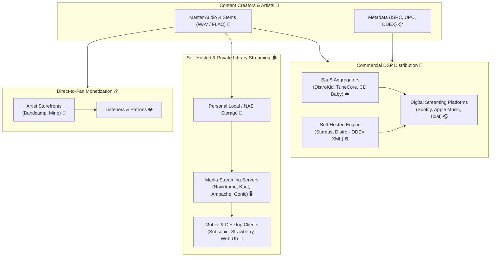

<p align="center">
  
</p>

# 🎵 Awesome Digital Media Management & Distribution 🚀

<p align="center">
  <a href="https://github.com/ishandutta2007/Awesome-Awesome-Awesome"></a>
  <a href="https://discord.gg/jc4xtF58Ve"></a>
  <a href="https://github.com/ishandutta2007/Awesome-Awesome-Awesome"></a>
  <a href="https://github.com/ishandutta2007"></a>
</p>

> 🎧 A curated, research-driven directory of premier **SaaS platforms** and **open-source tools** for digital media management, DIY music distribution, self-hosted streaming servers, DDEX catalog pipelines, and direct creator monetization.

---

## 📑 Table of Contents

- [📊 Sector Overview & Market Dynamics](#-sector-overview--market-dynamics)
- [☁️ SaaS Platforms & Aggregators](#️-saas-platforms--aggregators)
- [💻 Open-Source GitHub Projects](#-open-source-github-projects)
- [🏗️ Architecture & Deployment Scenarios](#️-architecture--deployment-scenarios)
- [🤝 How to Contribute](#-how-to-contribute)
- [💖 Support & Sponsorship](#-support--sponsorship)
- [⭐ Star History](#-star-history)
- [📜 License & Disclaimer](#-license--disclaimer)

---

## 📊 Sector Overview & Market Dynamics

The global **digital media and entertainment market** exceeds **$1.0 trillion**, with the specialized **digital music streaming and creator distribution** sector accounting for over **$35 billion to $40 billion** globally (projected to surpass $80 billion by the early 2030s at an ~8–12% CAGR). 📈

The industry exhibits **bifurcated market concentration**: consumer-facing streaming distribution is **highly concentrated** around dominant DSP giants (Spotify, Apple Music, YouTube Music) and major aggregator networks, while independent creator tooling, catalogue management, and direct-to-fan monetization remain **moderately fragmented** with intense competition among specialized SaaS aggregators (DistroKid, TuneCore, CD Baby, Bandcamp) and a rapidly surging ecosystem of privacy-first, self-hosted open-source streaming servers and federated media hubs. 🌐

---

## ☁️ SaaS Platforms & Aggregators

A comparative directory of cloud-hosted SaaS platforms for digital audio distribution, artist analytics, direct-to-fan sales, and royalty-free media licensing. Ranked in descending order by company valuation / market capitalization / annual gross revenue. 💼

| Product | 🏢 Company Scale (Valuation / Revenue) | 📝 Description | 💳 Starting Price | 🎁 Free Tier / Trial Limits |
|:---|:---|:---|:---|:---|
| **[Apple Music for Artists](https://artists.apple.com/)** | **~$3.4 Trillion** market cap (Apple Inc. parent) | Proprietary artist analytics, global audience insights, and asset management for catalog performance across Apple Music and Shazam. 🍎 | Free included with distribution partner | **100% Free forever** (requires verified artist account distributed via partner; no upload limits) |
| **[Spotify for Artists](https://artists.spotify.com/)** | **~$80+ Billion** market cap (~$16B annual revenue) | Direct artist analytics, promotional campaign suite (Marquee, Discovery Mode), profile canvas editor, and editorial playlist pitching. 🟢 | Free included with distribution partner | **100% Free forever** (requires verified artist account distributed via partner; includes full analytics and pitching access) |
| **[DistroKid](https://distrokid.com/)** | **~$2.0 Billion** valuation (~$97M annual revenue) | High-volume DIY digital music aggregator delivering tracks to 150+ streaming DSPs, digital stores, and social platforms with 100% royalty pass-through. 🚀 | **$22.99/year** (*Musician* plan for 1 artist/band) | **No free tier**; paid annual subscription required for upload and distribution |
| **[Epidemic Sound](https://www.epidemicsound.com/)** | **~$1.4 Billion** valuation (~$140M+ annual revenue) | Full-catalog soundtrack and sound effects licensing SaaS for content creators, agencies, and global commercial video productions. 🎬 | **$9.99/month** (*Creator* plan billed annually at $119.88/yr) | **30-day free trial** with full music access (must cancel before 30 days to avoid billing) |
| **[TuneCore](https://www.tunecore.com/)** | **~$1.0+ Billion** parent Believe Group revenue ($5B+ cumulative artist payouts) | International independent music distributor offering digital DSP releases, publishing administration, sync licensing, and monetization accelerators. 🎶 | **$14.99/year** (*Rising Artist* plan for unlimited releases, or $9.99 per single) | **New Artist Free plan** (social platforms only: TikTok, YouTube, Instagram, Facebook with 20% commission; DSP streaming distribution requires paid plan) |
| **[CD Baby](https://cdbaby.com/)** | **~$775 Million** parent Downtown Music acquisition by Virgin/UMG ($200M+ revenue) | Pioneer digital and physical music aggregator featuring one-time per-release fee structures with no ongoing annual subscription fees. 💿 | **$9.99** one-time fee per single or album | **No free tier**; one-time fee per release plus 9% digital distribution commission |
| **[Bandcamp](https://bandcamp.com/)** | **~$530 Million** parent Songtradr valuation ($1.3B+ paid to artists) | Direct-to-fan storefront and streaming platform enabling musicians to sell digital albums, vinyl, cassettes, merchandise, and subscriptions. 🏷️ | **Free to join & publish** (10% on physical merchandise, 15% on digital sales) | **100% Free forever** to register, upload unlimited catalog, and sell directly (revenue share waived on monthly Bandcamp Fridays) |
| **[SoundCloud](https://soundcloud.com/)** | **~$300 Million** valuation (~$210M annual revenue) | Creator-first audio streaming, social discovery, and direct fan engagement platform featuring embedded players and community commenting. ☁️ | **$8.25/month** (*Next Pro* plan billed annually at $99/yr) | **Next (Free tier)**: capped strictly at 3 hours total lifetime audio uploads and standard lossy streaming quality |

---

## 💻 Open-Source GitHub Projects

Explore self-hosted streaming servers, command-line collection organizers, DDEX distribution backends, and federated audio sharing platforms. Ranked in descending order by GitHub stargazers count. 🌟

| Project | ⭐ Stars_Count | 📝 Description | 🛠️ Primary Tech Stack |
|:---|:---:|:---|:---|
| **[Koel](https://github.com/koel/koel)** | [](https://github.com/koel/koel/stargazers) | Modern web-based personal audio streaming server with a clean Spotify-like UI, remote control features, and instant transcoding. 📻 | PHP, Laravel, Vue.js |
| **[Beets](https://github.com/beetbox/beets)** | [](https://github.com/beetbox/beets/stargazers) | The definitive media library management system and CLI tagger for music geeks. Autotags files using MusicBrainz, Discogs, and Spotify databases. 🏷️ | Python, SQLite |
| **[Navidrome](https://github.com/navidrome/navidrome)** | [](https://github.com/navidrome/navidrome/stargazers) | Lightweight, high-performance modern music server compatible with Subsonic/Airsonic clients. Low memory footprint with multi-user support. 🚀 | Go, React, SQLite |
| **[Strawberry](https://github.com/strawberrymusicplayer/strawberry)** | [](https://github.com/strawberrymusicplayer/strawberry/stargazers) | Audiophile desktop music player and collection organizer. Features bit-perfect playback, tag editing, scrobbling, and Subsonic streaming integration. 🍓 | C++, Qt6 |
| **[Ampache](https://github.com/ampache/ampache)** | [](https://github.com/ampache/ampache/stargazers) | Mature web-based audio/video streaming server and file manager with API support for Subsonic, DAAP, WebDAV, and UPnP/DLNA. 🔊 | PHP, MySQL, JavaScript |
| **[Gonic](https://github.com/sentriz/gonic)** | [](https://github.com/sentriz/gonic/stargazers) | Fast, lightweight Subsonic-compatible music streaming server with on-the-fly audio transcoding, podcast caching, and browse-by-folder support. ⚡ | Go, SQLite |
| **[OwnTone](https://github.com/owntone/owntone-server)** | [](https://github.com/owntone/owntone-server/stargazers) | Multi-room DAAP (iTunes) and MPD media server with native AirPlay 1 & 2, Chromecast, and Spotify streaming support. 🏠 | C, SQLite |
| **[Airsonic](https://github.com/airsonic/airsonic)** | [](https://github.com/airsonic/airsonic/stargazers) | Community-driven media streaming server providing ubiquitous access to large music and podcast libraries across diverse clients. ☁️ | Java, Spring Boot |
| **[Airsonic-Advanced](https://github.com/airsonic-advanced/airsonic-advanced)** | [](https://github.com/airsonic-advanced/airsonic-advanced/stargazers) | High-performance, actively optimized fork of Airsonic with modern Java support, faster scans, and enhanced caching mechanisms. 🚄 | Java |
| **[LMS (Lightweight Music Server)](https://github.com/epoupon/lms)** | [](https://github.com/epoupon/lms/stargazers) | Resource-friendly C++ music streaming server featuring acoustic fingerprint recommendation algorithms, Subsonic API, and web player. 🎼 | C++, Wt |
| **[ownCloud Music](https://github.com/owncloud/music)** | [](https://github.com/owncloud/music/stargazers) | Audio player and Subsonic/Ampache server extension for ownCloud and Nextcloud private cloud instances. ☁️ | PHP, JavaScript |
| **[Euterpe](https://github.com/ironsmile/euterpe)** | [](https://github.com/ironsmile/euterpe/stargazers) | Minimalist self-hosted streaming server with web UI, REST API, responsive design, and zero configuration setup. 🎧 | Go, HTML5 |
| **[Mirlo](https://github.com/funmusicplace/mirlo)** | [](https://github.com/funmusicplace/mirlo/stargazers) | Community-governed open-source Bandcamp alternative and artist patronage platform supporting direct-to-fan digital album sales. 🕊️ | Node.js, TypeScript |
| **[Songhive](https://github.com/blacklight/songhive)** | [](https://github.com/blacklight/songhive/stargazers) | Federated self-hosted audio streaming server utilizing ActivityPub protocol for decentralized social music sharing. 🐝 | Python, ActivityPub |
| **[Stardust Distro](https://github.com/daddykev/stardust-distro)** | [](https://github.com/daddykev/stardust-distro/stargazers) | Enterprise-grade, DDEX-compliant music distribution pipeline with automated ERN (3.8.2/4.2/4.3) feeds and multi-cloud delivery. ✨ | Node.js, TypeScript |

---

## 🏗️ Architecture & Deployment Scenarios



---

## 🤝 How to Contribute

We welcome community contributions from artists, software engineers, and digital media curators! 🎉

1. 🍴 **Fork this repository** to your personal GitHub account.
2. ✍️ **Add or update an entry** in [README.md](file:///C:/Users/ishan/Documents/Projects/Awesome-Digital-Media-Management/README.md).
   - For SaaS tools: ensure pricing and free tier/trial limits are specific and verifiable.
   - For Open-Source repositories: ensure the repository link and Stars_Badge follow the existing format:
     ```markdown
     | **[RepoName](https://github.com/owner/repo)** | [](https://github.com/owner/repo/stargazers) | Description | Tech Stack |
     ```
3. 💾 **Commit your changes** with a concise, descriptive commit message.
4. 🚀 **Submit a Pull Request** describing the addition and verifying all links.

---

## 💖 Support & Sponsorship

Thank you so much for exploring and using **Awesome-Digital-Media-Management**! 🌟

If you find this curated resource helpful for your projects, productions, or research, please consider supporting the project:

- ⭐ **Star this repository** to help others discover it on GitHub.
- 🍴 **Fork and share** it with your developer network, artist peers, or music communities.
- ☕ **Buy a coffee & sponsor**: Support continued curation and open-source maintenance via the [GitHub Sponsor Dashboard](https://github.com/sponsors/ishandutta2007).

Your encouragement and support keep this project vibrant and up to date! 🙏

---

## ⭐ Star History

[](https://www.star-history.com/#ishandutta2007/Awesome-Digital-Media-Management&type=date&legend=top-left)

---

## 📜 License & Disclaimer

- Distributed under the [CC0 1.0 Universal License](https://creativecommons.org/publicdomain/zero/1.0/).
- This curated directory is for educational and architectural reference purposes. Music distribution involves copyright management, mechanical royalties, and strict DSP delivery specifications; always verify licensing terms, cloud hosting prerequisites, and commission rates prior to releasing catalog media.
